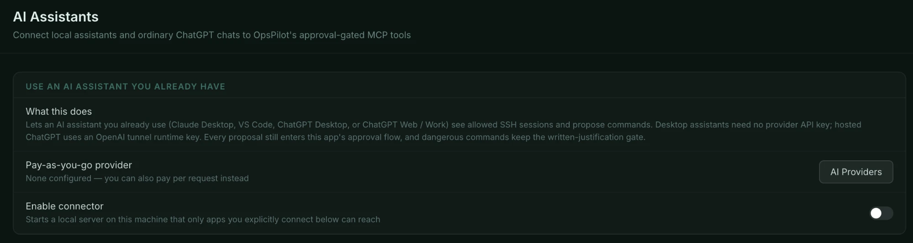
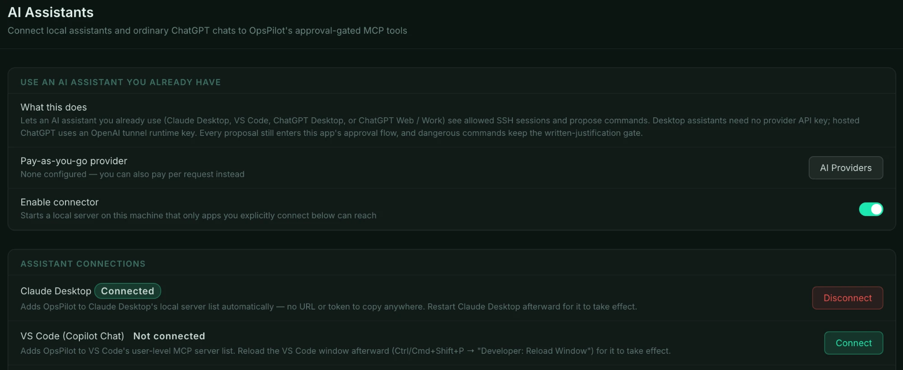
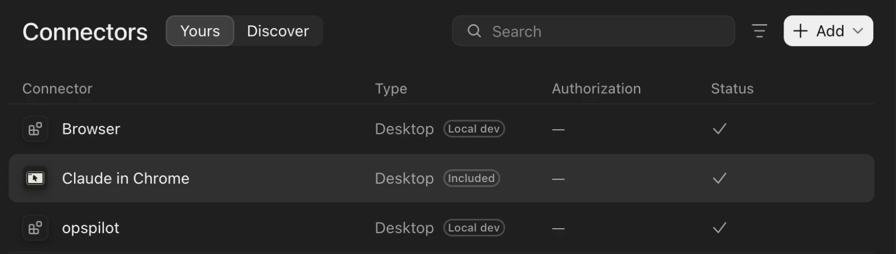
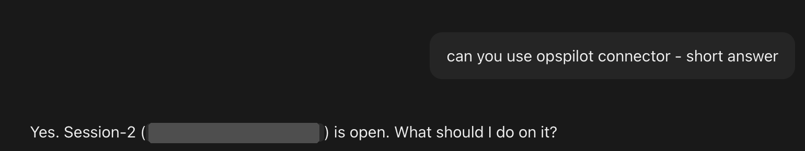
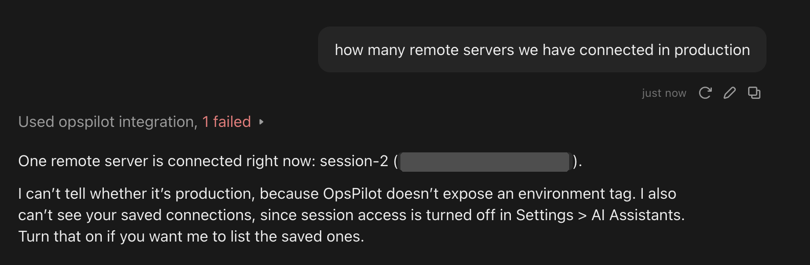
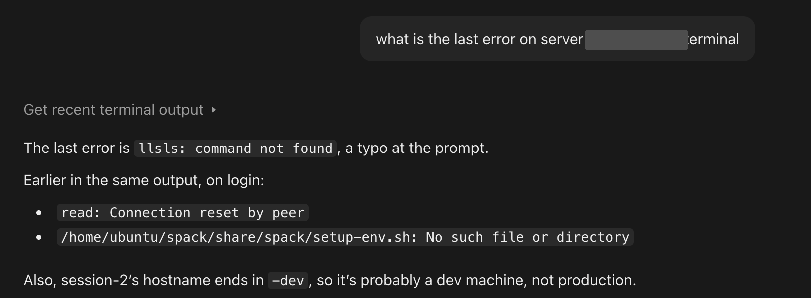

# AI Assistants (MCP)

If you already pay for Claude, ChatGPT or GitHub Copilot, you do not need an API
key as well. OpsPilot exposes itself as an MCP (Model Context Protocol) server on
`127.0.0.1`, and assistants you already use connect to it and gain a narrow set
of tools.

The assistant's model usage is covered by your Claude, ChatGPT or Copilot plan. Using
it with OpsPilot needs an active OpsPilot free trial or subscription. Without one,
**Settings → AI Assistants** shows a note saying why, you can still set everything up,
and a connected assistant is told the reason whenever it calls a tool. See
[Free trial and limits](../licensing/trial-and-limits.md).

## The four assistants

| Assistant | How it connects | Needs a provider API key? |
|---|---|---|
| Claude Desktop | One click, config written automatically | No |
| VS Code (Copilot Chat) | One click, user-level MCP config | No |
| ChatGPT Desktop | One click, shared with Codex CLI and IDE extensions | No |
| ChatGPT Web / Work | Secure tunnel, needs an OpenAI tunnel ID and runtime key | No |

## Connecting one

The steps below use Claude Desktop. VS Code and ChatGPT Desktop work the same way,
with a window reload or restart in step 4.

1. Open **Settings → AI Assistants**. On a new installation only the top group is
   there, and **Enable connector** is off.

    
    _The starting point. Nothing can reach OpsPilot yet. An assistant needs no provider
    API key, so **Pay-as-you-go provider** can stay at **None configured**._

2. Turn on **Enable connector**. This starts a local server that only the apps you
   explicitly connect can reach, and shows the **Assistant connections** group.

    
    _Each assistant has its own badge and button. **OpsPilot MCP service** reads
    **Running** once the local server is up._

3. Click **Connect** on the assistant you want. The badge changes to **Connected**
   and the button to **Disconnect**.

    
    _Claude Desktop is connected. The other assistants are unaffected until you
    connect them too._

4. Restart the assistant (or, for VS Code, reload the window). In Claude Desktop,
   OpsPilot then appears as **opspilot** in its own connector list.

    
    _In Claude Desktop, under **Settings → Connectors**. A tick under **Status** shows
    Claude Desktop has loaded it._

5. Ask the assistant something about an open session. With an SSH or Local Console
   tab open in OpsPilot, and **Enable AI** on for its connection, the assistant can
   see it.

    
    _The assistant found the open session through `list_sessions`. Sessions whose
    connection has AI off do not appear at all._

For the desktop assistants, OpsPilot writes the configuration itself — there is
no URL and no token to copy anywhere. It edits the assistant's own MCP
configuration file in place and will not overwrite a file it cannot parse, so
other MCP servers you already have configured survive.

The restart in step 4 is required: these assistants read their MCP configuration at
startup. After that the order does not matter: an assistant started before
OpsPilot still gets OpsPilot's tools once OpsPilot is running.

Each assistant shows a badge:

| Badge | Meaning |
|---|---|
| **Connected** | The assistant's configuration points at this OpsPilot. **Disconnect** removes it |
| **Not connected** | OpsPilot is not in the assistant's configuration |
| **Needs update** | The assistant is set up for another copy of OpsPilot (an older installation, say) or an old token. Click **Update** to point it at this OpsPilot, then restart the assistant |

**ChatGPT Web / Work** is the exception — a browser or phone cannot reach your
loopback interface, so it uses a tunnel instead of a config file. Its badge reads
**Not configured** until you click **Configure** and finish that setup, which has
its own page: [Remote & mobile operation](remote-mobile.md).

**Last verified activity** on the same page shows the most recent tool call
OpsPilot received from any connected assistant, which is the quickest way to
confirm a connection is actually live without leaving OpsPilot.

## What a working connection looks like

Once connected, ask in plain language. The assistant chooses the tool; Claude
Desktop shows which one it used above its answer.

A refused tool call is normal, and the assistant is told why. Here the assistant
tried `list_connections` while **Allow opening/reconnecting sessions** was off, so it
could see the open session but not the saved connections:

_The failed call is `list_connections`. Turning on session access, described
[below](#letting-an-assistant-open-sessions), is what lets an assistant list and open
saved connections._

A question about a session that is already open needs no session access:

_`get_recent_output` read the session's scrollback, after OpsPilot's redaction, and
the assistant summarised the errors in it. Reading needs no approval; a command it
wants to run would arrive in OpsPilot as a proposal._

## The six tools an assistant gets

| Tool | Access | Approval |
|---|---|---|
| `list_connections` | Saved connections you have allowed — and only when session access is on | None — read-only metadata |
| `list_sessions` | Open SSH and Local Console sessions that have AI on | None |
| `open_session` | Opens or reconnects an allowed connection | None — pre-authorised per connection |
| `get_recent_output` | Terminal scrollback of an SSH or Local Console session, **redacted** | None — read-only |
| `read_file` | A file over SFTP from an SSH session, **redacted** | None — read-only |
| `propose_command` | Proposes a shell command | **Yes — enters the approval flow** |

That is the entire surface:

- **No tool writes a file.** `read_file` reads; there is no counterpart.
- **No tool executes anything directly.** `propose_command` proposes.
- **No tool reads your credential store.** Passwords and private keys are not
  reachable through any of the six.

`list_sessions` marks a Local Console tab as local, with its platform and shell, so an
assistant proposes commands in that shell's syntax — and knows they run on your own
workstation. `read_file` works over SFTP, so it refuses a Local Console tab; an
assistant asks for a command such as `cat` or `Get-Content` there instead.

`propose_command` waits until you approve it, dismiss it, or it times out after
five minutes. To the assistant it is a call that waits for a human, and it is told
when the wait runs out. If the same session gets a newer proposal while an older
one is still waiting, the older one is superseded. If the session's Command Safety
profile lets that kind of command run without a click, it runs at once, exactly as a
proposal from OpsPilot's own panel would; a dangerous command always waits for you.

The tools also re-check permission at the point of use rather than trusting the
assistant's cached view: `get_recent_output`, `read_file` and `propose_command`
all refuse a session whose **Enable AI** has since been turned off, or whose AI the
license no longer allows, and `open_session` re-checks the per-connection
permission even for an id `list_connections` handed out earlier. A proposal still
waiting when AI goes off for its session is refused, and the assistant is told why.

The full input schema for each tool is in
[MCP tools](../reference/mcp-tools.md).

## Assistants and your license

Every tool checks the license before it does anything:

- **Without an active trial or subscription**, or while licensing is paused (for example
  while this computer's clock needs fixing), every tool refuses with the reason, such
  as *AI assistant access needs an active trial or subscription*. Refused calls still
  count as activity, so you can see the connection itself works.
- **During the free trial**, AI is on for 2 of your connections at a time, and only your
  first 10 saved connections can be opened. `list_sessions` lists only sessions that
  have AI, `list_connections` leaves out locked connections and connections that hold
  none of the trial's 2 AI places, and `open_session` refuses them with the reason.

## Letting an assistant open sessions

**Allow opening/reconnecting sessions** lets an assistant connect a saved
connection itself, so you can ask "check the status on the bastion" without
connecting first. Once enabled it happens without a click, unlike a proposed
command, which always meets your Command Safety profile.

It is therefore off by default and requires opting in twice:

| Control | Where | Default |
|---|---|---|
| **Allow opening/reconnecting sessions** | Settings → AI Assistants → Session access | Off |
| **Let AI Assistant open this session** | The connection dialog | Off |

Both have to be on for a given connection. With the master switch off,
`list_connections` and `open_session` both refuse and say so; with it on,
`list_connections` only ever returns connections you marked individually.

During the free trial an assistant can open only a connection that holds one of the 2
AI places, and not while AI is already on in 2 tabs of other connections, since the new
tab would open with AI off. It is told why, and you choose in OpsPilot where AI goes.
When it opens a connection that already has a tab with AI, it gets that tab.

Opening a session and approving a command are separate decisions, with separate
controls.

## The safety model with an external assistant

Nothing about the safety model weakens when the AI is external. A command
proposed by Claude Desktop:

- enters the **same approval queue** as OpsPilot's own panel uses
- carries the **same risk tier**, from the same Command Safety profile, and meets the
  same rules for what may run without a click
- needs the **same click** for a High risk command,
  and the same typed reason where the profile asks for one
- has its context and its output passed through the **same redaction layer**,
  using the same Data Handling profiles

The approval card shows a *via Claude Desktop* badge — taken from the connecting
client's own self-reported identity — so the source of a proposal is never
ambiguous.

The connector binds to `127.0.0.1` only. No public listener is opened, including
in the ChatGPT tunnel case. Binding to loopback stops other *machines* rather
than other local processes, so every request must also carry the bearer token
OpsPilot generated, and only the apps you connected have it.

!!! note "The connector is off until you turn it on"
    It is a new local listener, so it ships disabled. Turning it off again stops
    the server and resolves anything still waiting on a human.

## See also

- [Remote & mobile operation](remote-mobile.md) — ChatGPT Web/Work over the
  secure tunnel
- [MCP tools](../reference/mcp-tools.md) — each tool's parameters and returns
- [Approvals & auto-run](../safety/approvals.md) — what happens to a proposal
  once it reaches the queue
- [What gets sent](what-gets-sent.md) — one redaction policy for every AI path
